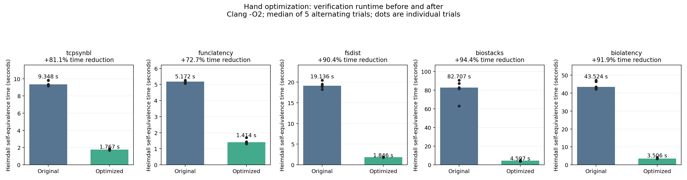

# Hand optimization: five real eBPF program pairs

All five pairs passed **39/39 original-to-optimized entry-point equivalence checks** with Heimdall. All ten C sources are beside this report. Upstream source files and the verifier were not modified.

The rewrite computes histogram logarithms with unsigned carry-bit arithmetic instead of comparison-driven branches. It returns the same bucket, including zero-input behavior, while creating fewer symbolic paths. All five examples use this one additional pattern; they are five distinct full programs.

## Verification runtime

Median of five alternating trials after one warm-up per variant, using one affected entry per program. Times cover the full Heimdall self-equivalence call, excluding compilation and Python/import startup. Both versions use Clang `-target bpfel -O2 -g -D__TARGET_ARCH_x86`. Inputs, volatile reads, helper-failure settings, and observations are unchanged; no witness or extra assumptions are supplied.

| Program and sources | Original (s) | Optimized (s) | Time reduction | Completed paths, original → optimized |
| --- | ---: | ---: | ---: | ---: |
| tcpsynbl — [original](tcpsynbl.original.bpf.c), [optimized](tcpsynbl.optimized.bpf.c) | 9.348 | 1.767 | 81.1% | 34 → 4 |
| funclatency — [original](funclatency.original.bpf.c), [optimized](funclatency.optimized.bpf.c) | 5.172 | 1.414 | 72.7% | 18 → 3 |
| fsdist — [original](fsdist.original.bpf.c), [optimized](fsdist.optimized.bpf.c) | 19.136 | 1.846 | 90.4% | 20 → 4 |
| biostacks — [original](biostacks.original.bpf.c), [optimized](biostacks.optimized.bpf.c) | 82.707 | 4.597 | 94.4% | 38 → 6 |
| biolatency — [original](biolatency.original.bpf.c), [optimized](biolatency.optimized.bpf.c) | 43.524 | 3.506 | 91.9% | 36 → 6 |

Dots show every individual trial; bars show medians. Each panel has its own zero-based seconds axis. No failed trials or regressions occurred in this run. These are verification times, not eBPF execution or C-to-Rust translation times.

## Proof and bytecode coverage

| Program | Timed entry | Exported entries proved | Instruction slots, original → optimized | Conditional jumps, original → optimized |
| --- | --- | ---: | ---: | ---: |
| tcpsynbl | `tcp_v4_syn_recv_kprobe` | 4/4 | 84 → 96 | 9 → 5 |
| funclatency | `dummy_kretprobe` | 4/4 | 136 → 161 | 19 → 14 |
| fsdist | `file_read_exit` | 20/20 | 810 → 1000 | 110 → 60 |
| biostacks | `blk_account_io_done` | 5/5 | 471 → 509 | 40 → 30 |
| biolatency | `block_rq_complete_btf` | 6/6 | 490 → 509 | 47 → 42 |

The arithmetic form can increase bytecode size while reducing symbolic branching. Proofs cover every exported entry under Heimdall’s existing model and reject unfinished/error stashes. Kernel verifier acceptance was not tested.

## Reproduce and inspect

[Benchmark instructions](README.md) · [Source provenance and fixed protocol](manifest.json) · [Raw results](results/20261027T214307Z/results.json) · [Compiler environment](results/20261027T214307Z/environment.json) · [SVG chart](runtime-comparison.svg)

Recorded run: `results/20261027T214307Z`. Each program’s subdirectory there contains the complete per-call proof logs and JSON results. The `build/` directory contains all ten compiled objects and compiler-command logs.
