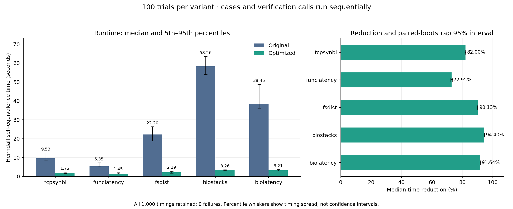

# Five-program 100-trial stability results

All five cases completed sequentially, using one Luna agent and the frozen protocol. Each case has 100 original and 100 optimized observations: **1,000 successful timed calls, zero failures/timeouts/interrupted calls, and 39/39 exported-entry equivalence proofs passed**. All samples, including outliers, are retained.

| Program | Original median s | Optimized median s | Reduction | Paired-bootstrap 95% interval | Proofs |
| --- | ---: | ---: | ---: | --- | ---: |
| [tcpsynbl](tcpsynbl/AGENT_NOTES.md) | 9.533 | 1.716 | 82.00% | 81.73–82.21% | 4/4 |
| [funclatency](funclatency/AGENT_NOTES.md) | 5.352 | 1.448 | 72.95% | 72.37–73.63% | 4/4 |
| [fsdist](fsdist/AGENT_NOTES.md) | 22.200 | 2.190 | 90.13% | 90.01–90.23% | 20/20 |
| [biostacks](biostacks/AGENT_NOTES.md) | 58.260 | 3.264 | 94.40% | 94.32–94.52% | 5/5 |
| [biolatency](biolatency/AGENT_NOTES.md) | 38.453 | 3.214 | 91.64% | 91.48–91.84% | 6/6 |

## Stability

The before/after reductions are repeatable in these observations, but absolute timing stability varies. `biostacks` has the lowest relative variation and little directional drift. The other four cases show slow clusters, level shifts, drift, or larger outliers. No formal stationarity test was prespecified; these assessments describe the saved series, quantiles, and ten-round block medians.

| Program | Original CV | Optimized CV | First-to-last 25 median change, original / optimized |
| --- | ---: | ---: | --- |
| tcpsynbl | 11.84% | 24.35% | +5.94% / +6.03% |
| funclatency | 12.90% | 14.18% | -20.09% / -10.12% |
| fsdist | 9.71% | 13.61% | +1.04% / +5.52% |
| biostacks | 5.10% | 4.58% | +1.44% / -1.84% |
| biolatency | 10.74% | 6.72% | +9.18% / +7.80% |

CV is sample standard deviation divided by mean; lower is less relative variation. First/last comparisons can hide changes in the middle, so inspect each case's full chart and notes.

- **tcpsynbl:** late slowdown; optimized maximum 5.613 s in round 95; relatively high optimized CV.
- **funclatency:** early calls are slower, followed by lower timing levels. Full-run stationarity is not established.
- **fsdist:** level shift after the first ten rounds and several elevated clusters, despite similar first/last medians.
- **biostacks:** comparatively narrow bands, little directional drift; retained maxima 66.146 s original and 4.054 s optimized.
- **biolatency:** slow cluster around rounds 34–43 and higher last-25 medians; full-run stationarity is not established.

The fixed 10,000-resample paired bootstrap (seed 984) resamples individual whole rounds. It describes this run's median reduction; serial dependence and drift can make these intervals optimistic. They do not establish stationarity or predict timing on another machine/day.

## What was timed

The unchanged worker times the complete `run_verification` call for a selected entry, original against itself and optimized against itself. This matches the prior five-trial comparison. Imports, process startup, compilation, and reporting are excluded. These are not eBPF execution times or timings of an original-to-optimized proof. Correctness is checked separately with original-to-optimized proofs for every exported entry under Heimdall's existing model and defaults. No added input assumptions or reduced observations were used.

Each round runs in fresh processes, alternating original-first/optimized-first (50 rounds each). There is one untimed warm-up per variant and an unchanged 120-second process limit. Clang 22.1.8 compiles both versions with the same `bpfel -O2` flags. See [the protocol](../../PROTOCOL_100.md) and each case's `protocol.json` for frozen configuration and hashes.

Luna reached its usage limit during `biolatency`, but the existing controller kept running. After the user requested continuation, the same agent reattached to it. No controller or trial was restarted, and no sample was lost or replaced. The slowdown cluster is retained without attributing it to a particular cause.

## Saved artifacts and audit

[Benchmark runner](../../benchmark_100_trials.py) · [Summary/plot generator](../../summarize_100_trials.py) · [Machine-readable summary](summary-100.json) · [Audit](audit.json) · [SVG figure](runtime-comparison-100.svg)

The audit confirms 1,049 unique serial verification calls (1,000 timed + 10 warm-ups + 39 proofs), no overlapping calls, balanced alternating order, previous case notes written before the next case started, all ten source hashes unchanged, and identical frozen compiler/dependency/code fingerprints across cases. The source, verifier, backend, header, and runner hashes still match their pre-run records. Each case retains per-call attempt markers, JSON, logs, journal, statistics, and full timing charts. Earlier five-trial artifacts were not overwritten.
