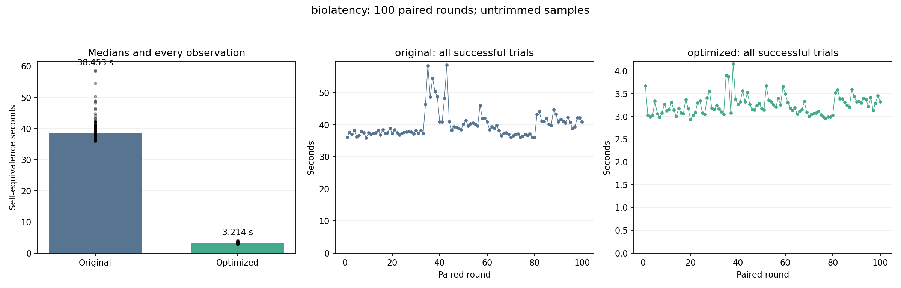

# biolatency: 100-trial stability benchmark

Status: **COMPLETE**.

100 planned paired rounds: 100 original and 100 optimized self-equivalence calls. Fresh worker per call; identical Clang -O2 inputs and defaults; 120-second process limit. One untimed warm-up per version. Every exported entry is checked original-to-optimized.

No samples are trimmed or replaced. Failed/timeout/interrupted calls are listed separately; statistics below describe successful calls only. An incomplete run is not a successful 100-trial result.

| Variant | Successful | Failed rounds | Median s | Mean s | SD s | CV % | p05–p95 s | Min–max s |
| --- | ---: | --- | ---: | ---: | ---: | ---: | --- | --- |
| original | 100/100 | [] | 38.453197 | 39.949930 | 4.292589 | 10.74 | 36.141334–48.731554 | 35.914915–58.679487 |
| optimized | 100/100 | [] | 3.213723 | 3.254158 | 0.218724 | 6.72 | 2.990725–3.666857 | 2.933897–4.153589 |

Median time reduction: **91.64%**.
Paired-bootstrap 95% interval: **91.48% to 91.84%**, using 100 complete pairs (10,000 resamples; fixed seed 984).

## Proofs

- `block_rq_complete_btf`: PASS.
- `block_rq_insert_btf`: PASS.
- `block_rq_issue_btf`: PASS.
- `block_rq_insert`: PASS.
- `block_rq_issue`: PASS.
- `block_rq_complete`: PASS.

## Stability and drift

Large CV/IQR or a change in the first/last-25 medians indicates timing variability. A positive speedup interval addresses the before/after difference, not stationarity of either process.

| Variant | First-25 median s | Last-25 median s | IQR s | MAD s |
| --- | ---: | ---: | ---: | ---: |
| original | 37.450586 | 40.887937 | 3.709248 | 1.646280 |
| optimized | 3.083644 | 3.324203 | 0.267227 | 0.132264 |

[Raw summary and per-round results](summary.json) · [Frozen protocol](protocol.json) · [Append-only call journal](journal.jsonl)

Heimdall default helper-failure mode is off. No extra witness, input restriction, or observation restriction is used. These are selected-entry self-equivalence timings; they are not kernel execution or C-to-Rust translation times.
