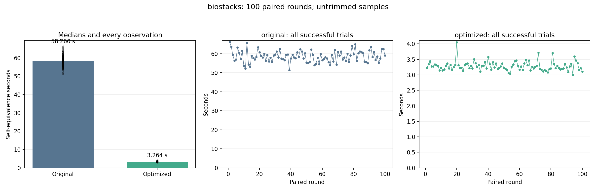

# biostacks: 100-trial stability benchmark

Status: **COMPLETE**.

100 planned paired rounds: 100 original and 100 optimized self-equivalence calls. Fresh worker per call; identical Clang -O2 inputs and defaults; 120-second process limit. One untimed warm-up per version. Every exported entry is checked original-to-optimized.

No samples are trimmed or replaced. Failed/timeout/interrupted calls are listed separately; statistics below describe successful calls only. An incomplete run is not a successful 100-trial result.

| Variant | Successful | Failed rounds | Median s | Mean s | SD s | CV % | p05–p95 s | Min–max s |
| --- | ---: | --- | ---: | ---: | ---: | ---: | --- | --- |
| original | 100/100 | [] | 58.260161 | 58.523599 | 2.986200 | 5.10 | 53.920804–63.510454 | 51.287588–66.145736 |
| optimized | 100/100 | [] | 3.263544 | 3.282625 | 0.150445 | 4.58 | 3.101266–3.512891 | 3.003125–4.054261 |

Median time reduction: **94.40%**.
Paired-bootstrap 95% interval: **94.32% to 94.52%**, using 100 complete pairs (10,000 resamples; fixed seed 984).

## Proofs

- `blk_account_io_done`: PASS.
- `blk_account_io_merge_bio`: PASS.
- `blk_account_io_start`: PASS.
- `block_io_start`: PASS.
- `block_io_done`: PASS.

## Stability and drift

Large CV/IQR or a change in the first/last-25 medians indicates timing variability. A positive speedup interval addresses the before/after difference, not stationarity of either process.

| Variant | First-25 median s | Last-25 median s | IQR s | MAD s |
| --- | ---: | ---: | ---: | ---: |
| original | 58.922160 | 59.771231 | 4.233099 | 1.980497 |
| optimized | 3.274563 | 3.214395 | 0.155571 | 0.081612 |

[Raw summary and per-round results](summary.json) · [Frozen protocol](protocol.json) · [Append-only call journal](journal.jsonl)

Heimdall default helper-failure mode is off. No extra witness, input restriction, or observation restriction is used. These are selected-entry self-equivalence timings; they are not kernel execution or C-to-Rust translation times.
