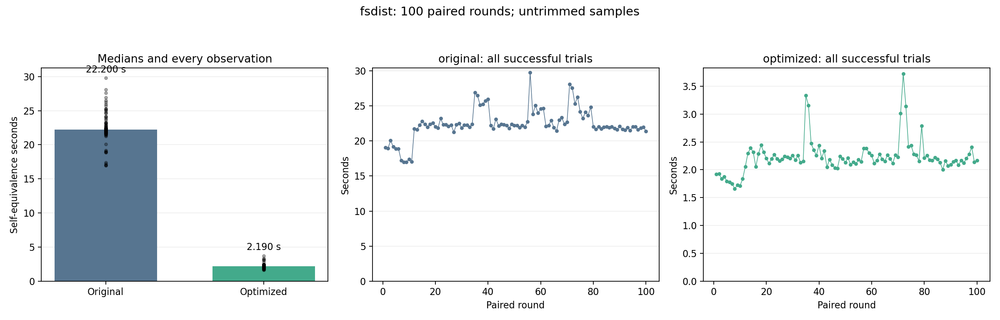

# fsdist: 100-trial stability benchmark

Status: **COMPLETE**.

100 planned paired rounds: 100 original and 100 optimized self-equivalence calls. Fresh worker per call; identical Clang -O2 inputs and defaults; 120-second process limit. One untimed warm-up per version. Every exported entry is checked original-to-optimized.

No samples are trimmed or replaced. Failed/timeout/interrupted calls are listed separately; statistics below describe successful calls only. An incomplete run is not a successful 100-trial result.

| Variant | Successful | Failed rounds | Median s | Mean s | SD s | CV % | p05–p95 s | Min–max s |
| --- | ---: | --- | ---: | ---: | ---: | ---: | --- | --- |
| original | 100/100 | [] | 22.200431 | 22.406493 | 2.176759 | 9.71 | 18.803161–26.297254 | 16.974913–29.774034 |
| optimized | 100/100 | [] | 2.190338 | 2.224352 | 0.302657 | 13.61 | 1.794546–2.802661 | 1.660408–3.724156 |

Median time reduction: **90.13%**.
Paired-bootstrap 95% interval: **90.01% to 90.23%**, using 100 complete pairs (10,000 resamples; fixed seed 984).

## Proofs

- `file_read_exit`: PASS.
- `file_read_entry`: PASS.
- `file_write_entry`: PASS.
- `file_write_exit`: PASS.
- `file_open_entry`: PASS.
- `file_open_exit`: PASS.
- `file_sync_entry`: PASS.
- `file_sync_exit`: PASS.
- `getattr_entry`: PASS.
- `getattr_exit`: PASS.
- `file_read_fentry`: PASS.
- `file_read_fexit`: PASS.
- `file_write_fentry`: PASS.
- `file_write_fexit`: PASS.
- `file_open_fentry`: PASS.
- `file_open_fexit`: PASS.
- `file_sync_fentry`: PASS.
- `file_sync_fexit`: PASS.
- `getattr_fentry`: PASS.
- `getattr_fexit`: PASS.

## Stability and drift

Large CV/IQR or a change in the first/last-25 medians indicates timing variability. A positive speedup interval addresses the before/after difference, not stationarity of either process.

| Variant | First-25 median s | Last-25 median s | IQR s | MAD s |
| --- | ---: | ---: | ---: | ---: |
| original | 21.766957 | 21.993864 | 1.119514 | 0.473385 |
| optimized | 2.055008 | 2.168511 | 0.158345 | 0.076751 |

[Raw summary and per-round results](summary.json) · [Frozen protocol](protocol.json) · [Append-only call journal](journal.jsonl)

Heimdall default helper-failure mode is off. No extra witness, input restriction, or observation restriction is used. These are selected-entry self-equivalence timings; they are not kernel execution or C-to-Rust translation times.
