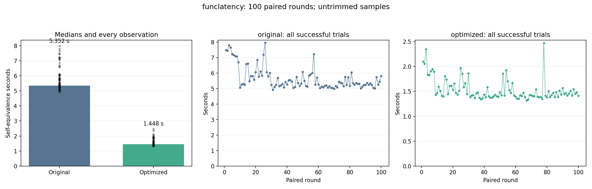

# funclatency: 100-trial stability benchmark

Status: **COMPLETE**.

100 planned paired rounds: 100 original and 100 optimized self-equivalence calls. Fresh worker per call; identical Clang -O2 inputs and defaults; 120-second process limit. One untimed warm-up per version. Every exported entry is checked original-to-optimized.

No samples are trimmed or replaced. Failed/timeout/interrupted calls are listed separately; statistics below describe successful calls only. An incomplete run is not a successful 100-trial result.

| Variant | Successful | Failed rounds | Median s | Mean s | SD s | CV % | p05–p95 s | Min–max s |
| --- | ---: | --- | ---: | ---: | ---: | ---: | --- | --- |
| original | 100/100 | [] | 5.352412 | 5.666222 | 0.730837 | 12.90 | 5.046050–7.241064 | 4.920738–7.977148 |
| optimized | 100/100 | [] | 1.447933 | 1.533358 | 0.217376 | 14.18 | 1.355796–1.950678 | 1.319866–2.473108 |

Median time reduction: **72.95%**.
Paired-bootstrap 95% interval: **72.37% to 73.63%**, using 100 complete pairs (10,000 resamples; fixed seed 984).

## Proofs

- `dummy_kretprobe`: PASS.
- `dummy_fentry`: PASS.
- `dummy_kprobe`: PASS.
- `dummy_fexit`: PASS.

## Stability and drift

Large CV/IQR or a change in the first/last-25 medians indicates timing variability. A positive speedup interval addresses the before/after difference, not stationarity of either process.

| Variant | First-25 median s | Last-25 median s | IQR s | MAD s |
| --- | ---: | ---: | ---: | ---: |
| original | 6.585516 | 5.262266 | 0.638749 | 0.257041 |
| optimized | 1.616961 | 1.453285 | 0.167506 | 0.059569 |

[Raw summary and per-round results](summary.json) · [Frozen protocol](protocol.json) · [Append-only call journal](journal.jsonl)

Heimdall default helper-failure mode is off. No extra witness, input restriction, or observation restriction is used. These are selected-entry self-equivalence timings; they are not kernel execution or C-to-Rust translation times.
