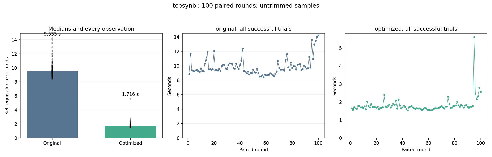

# tcpsynbl: 100-trial stability benchmark

Status: **COMPLETE**.

100 planned paired rounds: 100 original and 100 optimized self-equivalence calls. Fresh worker per call; identical Clang -O2 inputs and defaults; 120-second process limit. One untimed warm-up per version. Every exported entry is checked original-to-optimized.

No samples are trimmed or replaced. Failed/timeout/interrupted calls are listed separately; statistics below describe successful calls only. An incomplete run is not a successful 100-trial result.

| Variant | Successful | Failed rounds | Median s | Mean s | SD s | CV % | p05–p95 s | Min–max s |
| --- | ---: | --- | ---: | ---: | ---: | ---: | --- | --- |
| original | 100/100 | [] | 9.532666 | 9.867794 | 1.168757 | 11.84 | 8.676424–12.418151 | 8.397213–14.196546 |
| optimized | 100/100 | [] | 1.715769 | 1.809761 | 0.440659 | 24.35 | 1.567804–2.326323 | 1.529098–5.613332 |

Median time reduction: **82.00%**.
Paired-bootstrap 95% interval: **81.73% to 82.21%**, using 100 complete pairs (10,000 resamples; fixed seed 984).

## Proofs

- `tcp_v4_syn_recv_kprobe`: PASS.
- `tcp_v6_syn_recv_kprobe`: PASS.
- `tcp_v4_syn_recv`: PASS.
- `tcp_v6_syn_recv`: PASS.

## Stability and drift

Large CV/IQR or a change in the first/last-25 medians indicates timing variability. A positive speedup interval addresses the before/after difference, not stationarity of either process.

| Variant | First-25 median s | Last-25 median s | IQR s | MAD s |
| --- | ---: | ---: | ---: | ---: |
| original | 9.441845 | 10.003088 | 0.928168 | 0.467299 |
| optimized | 1.709805 | 1.812972 | 0.149939 | 0.073412 |

[Raw summary and per-round results](summary.json) · [Frozen protocol](protocol.json) · [Append-only call journal](journal.jsonl)

Heimdall default helper-failure mode is off. No extra witness, input restriction, or observation restriction is used. These are selected-entry self-equivalence timings; they are not kernel execution or C-to-Rust translation times.
